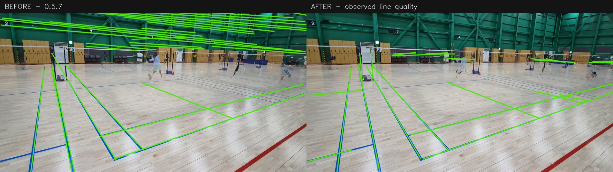

# 코트 라인 탐지 개선 — 0.5.8

이 변경은 코트선 후보를 더 정확하게 찾고, 전체 코트 좌표 보정이 확인되지 않은 영상에서도 실제로 찾은 선을 보여준다. 부분 시야를 전체 코트로 잘못 승인하는 경우도 차단한다. 코트선 검출과 전체 코트의 미터 좌표·IN/OUT 확정은 서로 다른 결과다.

## 확인된 원인과 변경

- 기존 색상 선택은 파란 픽셀이 화면의 0.15%만 넘어도 흰 선을 버렸다. 색을 독립적으로 검사하고 코트 기하와 연속된 선의 지지로 선택한다. 흰색·파란색·청록색·노란색, 저조도와 그림자를 처리한다.
- 넓은 파란 바닥, 녹색 벽, 목재 무늬가 선 마스크에 들어왔다. 주변 대비와 가는 색상 띠를 추출하고, 지나치게 밀집한 질감에는 대비 기준을 높인다. 템플릿 점수는 관측한 유한 선분의 방향과 위치까지 일치해야 인정한다.
- 가장 긴 Hough 선의 가장자리를 그대로 쓰면 두꺼운 테이프의 코너가 밀렸다. 선에 수직인 단면에서 양쪽 가장자리를 찾아 중심을 다시 맞춘다. 짧고 먼 선도 후보에 포함한다.
- 최대 9개 프레임의 중앙값 배경과 반복되는 색상 증거를 결합해 움직이는 사람의 가림을 줄인다. 카메라 안정성 검사는 별도로 유지한다.
- 부분 코트에서는 앞쪽/지정 영역의 주요 바닥색과 선 주변의 색·밝기를 비교해 벽·천장 구조물을 줄인다. 두 가지 이상 바닥색, 한쪽 색이 다른 경계선, 충분한 전체 코트 정합, 바닥 가정이 성립하지 않는 경우의 우회를 포함한다.
- 화면 밖 베이스라인을 서비스라인으로 바꾸어 맞춘 잘못된 성공을 막는다. 양쪽 끝의 서비스라인 배치 증거를 확인하고, 면적이 비슷해도 코너 대응이 다른 가설은 서로 다른 좌표계로 비교한다.
- 기존 화면은 보정 `ok` 외곽선만 표시해 `review`에서 선이 전혀 없는 것처럼 보였다. 이제 A/B 결과에 탐지 선분 수와 `evidence/calibration.jpg`를 제공하고, 개요·근거 영상에도 관측된 선을 표시한다. 카메라 이동이 확인되면 고정 선은 진단 이미지에만 표시한다.

## 실제 영상 평가 범위

저장소의 같은 체육관 영상 8개, 4개 촬영 유형의 A/B 시점을 사용했다. 원본과 프레임의 SHA256, 960×540 분석 좌표, 영상마다 9개 프레임 위치는 [manifest.json](court-calibration/manifest.json)에 고정했다. 기존 모듈은 `59c20cbf94d3d325651c3f71cabba9a2a80fa576`의 0.5.7 코드다.

각 영상의 확실히 보이는 주요 바닥선 5개, 총 40개의 근사 AI 시각 참조에서 선마다 64개 지점을 검사한다. 실제 검출된 **유한 선분**과 5px 이내인 지점의 비율을 측정한다. 별도로 명백한 벽·천장 영역 안에 들어간 검출 선분 길이를 합산한다. 참조선·비코트 영역은 평가에만 사용하며 추론에 전달하지 않는다. 모든 바닥선의 완전한 정답이나 독립 사람의 정답이 아니므로 전체 정밀도·재현율 또는 다른 체육관에 대한 성능으로 해석하지 않는다.

이 영상들은 코트 일부와 인접 코트가 함께 보여 전체 코트의 모든 경계를 독립 확인할 수 없다. 선 검출 개선을 전체 코트 보정 성공률이나 IN/OUT 정확도로 바꾸어 보고하지 않는다. 반복 실험과 채택하지 않은 설정도 [experiments.json](court-calibration/experiments.json)에 남긴다.

| 측정 항목 | 0.5.7 | 0.5.8 |
| --- | ---: | ---: |
| 주요 참조선 샘플의 5px 이내 검출 비율 | 95.90% | 97.42% |
| 샘플 80% 이상을 검출한 참조선 | 37/40 | 37/40 |
| 명백한 벽·천장 영역의 검출 선 길이 | 42,021.9px | 7,054.8px |
| 코트선 후보가 있는 영상 | 8/8 | 8/8 |
| 전체 코트 보정 승인 | 0/8 | 0/8 |

벽·천장 영역의 검출 선 길이는 **83.2% 감소**했다. case_01의 참조 샘플 검출 비율은 99.06%→95.00%로 감소했고, case_03의 비코트 선 길이도 1,494→1,957px로 증가했다. 나머지 참조 샘플 비율은 유지되거나 개선됐다. **모든 영상이 개선됐거나 전체 좌표 보정이 해결됐다고 주장하지 않는다.** 원본·최종 수치, 비교 이미지와 한계는 [상세 평가](court-calibration/README.md), [comparison.json](court-calibration/comparison.json), [final.json](court-calibration/final.json)에 있다.



## 최종 검증

- 전체 Python 테스트 **1,033개 통과**, GPU 장비가 필요한 5개는 미실행. 색상·저조도·가림·두꺼운 테이프·부분 코트·다중 바닥색·흰 표지판·청록색·빈 프레임 회귀를 포함한다.
- 실제 영상에서 만든 무손실 배경 이미지 2개로 목재 무늬가 파란 코트선을 밀어내는 회귀를 별도 검사했다. 이 테스트의 단일 배경 입력은 위 9프레임 정량 평가와 다르다.
- A/B 브라우저 UI 테스트 통과: 데스크톱과 375px 모바일, 업로드 1회·분석 요청 6회. JavaScript 구문 및 diff 검사 통과.
- `b시점 7.mp4`를 현재 `configs/poc.json`으로 원본부터 전체 분석했다. 파란 선분 28개와 라인 진단 이미지·개요·근거 MP4를 생성했고, 최종 판정은 `REVIEW`다. 전체 처리 약 73.8초 중 코트/카메라 확인 약 4.6초이며, 별도 속도 비교 결과는 아니다.
- 영상 해시, 분석 코드 지문, 모듈 SHA256, 결과/이미지/MP4 해시는 [validation.json](court-calibration/validation.json)에 기록했다. 평가한 최종 모듈의 SHA256은 `36f4687f86887fa2b104d309400065c4fc0e69f10f97783d906beb1ee8222dcc`다.

## 실행과 재현

Windows 0.5.8을 새 폴더에 모두 압축 해제하고 `START.bat`를 실행한다. A/B 영상을 선택한 뒤 **기존 검수 재사용을 끄고 새 분석**을 실행해야 변경이 적용된다. 결과의 **코트 라인 탐지**에서 하늘색 관측 선분과 전체 좌표 보정 상태를 따로 확인한다. 노란 외곽선은 전체 코트 정합 조건을 통과했을 때만 표시한다.

```bash
python -m pytest -q
node tests/test_pair_region_ui.cjs
git show 59c20cbf94d3d325651c3f71cabba9a2a80fa576:badminton/calibration.py > /tmp/calibration-baseline.py
python scripts/evaluate_calibration.py \
  --manifest docs/court-calibration/manifest.json \
  --cache-root runs/court-calibration/cache \
  --module /tmp/calibration-baseline.py --output runs/court-calibration/baseline
python scripts/evaluate_calibration.py \
  --manifest docs/court-calibration/manifest.json \
  --cache-root runs/court-calibration/cache --output runs/court-calibration/current
```

프레임 캐시가 없으면 manifest의 원본 영상이 저장소 `video/`에 있어야 한다. 영상은 실행 패키지에 포함하지 않는다. CLI의 `court_hint.roi_polygon_px`는 분석 이미지 좌표의 탐지 영역을 지정하며 수동 미터 좌표를 제공하지 않는다. `calibration.floor_context: false`로 바닥 맥락 필터를 끌 수 있다. 지정 ONNX 라인 모델에는 이 필터가 기본 적용되지 않는다.

## 한계

바닥 맥락은 영상 아래쪽 또는 지정 ROI의 색 분포를 이용한 휴리스틱이다. 코트 대부분이 잘리거나 가려지고, 바닥과 벽이 비슷하거나 복잡한 바닥에서는 오탐·누락이 남을 수 있다. 해당 영역의 색 분포가 불명확하면 필터를 우회하며, 전체 코트 정합이 충분하면 색 가정 때문에 정합 선을 버리지 않는다. 부분 선의 역할을 확인할 수 없으면 전체 코트 미터 좌표는 제공하지 않는다.

렌즈 보정·카메라 안정성·최초 접촉·대상 셔틀 식별·판정 불확실성의 기존 조건은 유지한다. 이번 작업은 모든 영상을 자동 `IN/OUT`으로 바꾸는 변경이 아니다. 테스트와 영상 검증은 Linux CPU에서 수행하며 Windows 실행 파일 및 실제 GPU 하드웨어 실행은 별도 확인이 필요하다.
