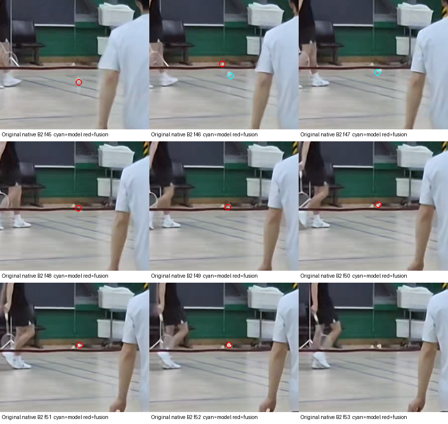

# 실험용 TrackNetV3 검토 — 이번 배포 제외

TrackNetV3 후보를 기존 CV 탐지에 추가하면 개발 영상 B2의 첫 착지 부근을 더 잘 선택했습니다. 그러나 모델 단독 실행은 5B와 A2에서 다른 위치를 선택했고, B2 합성 경로에도 배경 물체로 바뀐 관측이 하나 있었습니다. **이번 CV 배포에는 학습 모델 기능이나 가중치를 포함하지 않습니다.** 아래는 개발 영상 3개에 대한 연구 기록이며 일반화 성능·물리적 접촉·IN/OUT 정확도 검증이 아닙니다. 홀드아웃은 열지 않았고 동결된 시각 참조도 수정하지 않았습니다.

## 모델과 방법

원본은 [qaz812345/TrackNetV3](https://github.com/qaz812345/TrackNetV3/tree/6eda442ada1740573f200f836d93edc9a541ee86)의 추적 모델입니다. [MIT 라이선스](generalization/model-research/LICENSE-TrackNetV3.txt)는 사전 학습 체크포인트도 명시적으로 포함합니다. 사용한 ONNX는 [고정된 미러 커밋](https://github.com/gob123th/Badminton-Generate-HUD/tree/914605330c54f25b66af6f57e328e029811bc62c)에서 받은 **45,358,143바이트(약45MB)** 파일입니다. 다운로드 주소·저자·커밋·SHA256은 [출처 기록](generalization/model-research/provenance.json)에 보존합니다. 모델 바이트 해시는 확인했지만 upstream 원본 체크포인트와의 비트 동일성은 독립 확인하지 않았습니다. 가중치 파일은 이 저장소·패키지 자산에 복사하지 않았습니다.

각 개발 영상의 모든 실제 프레임을 8개씩 처리했습니다. 이미 디코딩한 960×540 원본 픽셀 캐시에 **고정 2×2 겹침 타일**을 적용했습니다. 각 타일은 화면의 60% 크기이며 시작점은 0%/40%입니다. 전체 영상의 중앙값 배경과 실제8프레임을 RGB·512×288·OpenCV INTER_CUBIC·NCHW·÷255로 입력했습니다. 히트맵 임계값은 **0.5**, 추가 후보는 프레임당 최대8개이며 기존 CV 후보는 보존했습니다. 마지막 묶음의 입력 패딩만 마지막 실제 프레임을 반복하고 가상 프레임 출력은 버렸습니다. 전체 영상 추론·후보 선택에는 참조 좌표나 착지 시각 힌트를 입력하지 않았습니다. InpaintNet·추가 학습은 사용하지 않았습니다. [어댑터 v1](generalization/model-research/adapter-v1.py)·[v2](generalization/model-research/adapter-v2.py)는 실행 당시 코드 보관본이며 제품 API가 아닙니다.

[픽셀·후보 무결성 검사](generalization/model-research/SOURCE_PATCH_INTEGRITY.json)는 기존 CV 관측 24,080개 보존, 모델 관측 544개 추가, 기록된 회색조 픽셀 19,587개의 캐시 일치와 프레임·시각 일치를 확인했습니다. 이는 입력 보존 검사이며 같은 셔틀 신원이나 접촉 확인을 대신하지 않습니다.

## 동일 소스의 세 방식 비교

추적·이벤트·판정 재생은 커밋 `d7f3d3303daa40c699d579c17e40269173220937`, 실행 지문 `42effbc814d2367a4e36d4ae843aa15fb09921d2dd8e4f8a14cb539e4dc9071a`로 통일했습니다. 프레임은 0부터 시작하고 좌표는 960×540 물체 중심 근사값입니다. 모든 결과는 `REVIEW`이며 네이티브 접촉 정밀화는 실행하지 않았습니다.

| 개발 영상 | CV 단독 대표 후보 | 모델 단독 대표 후보 | 합성 대표 후보 | 해석 |
|---|---|---|---|---|
| B2 (`8k-2-b`) | 12 · (727.4,179.4) | 45 · (419.6,206.4) | 45 · (419.6,206.4) | 원본의 실제 하강·반등 부근으로 개선; 경로 전체 신원 확인은 아님 |
| 5B (`8k-5-b`) | 39 · (818.7,298.7) | 13 · (364.5,166.5) | 39 · (818.7,298.7) | 모델 단독 실패; 합성은 기존 CV 후보 유지 |
| A2 (`8k-2-a`) | 84 · (284.8,369.0) | 97 · (789.0,181.1) | 84 · (284.8,369.0) | 모델 단독 실패; 합성은 기존 CV 후보 유지 |

5B와 A2 합성의 선택 경로에는 모델 관측이 들어가지 않았습니다. B2의 시각 참조와 약0.84픽셀 차이는 **근사 AI 참조와의 개발 대조값**이며 계측 정밀도가 아닙니다. 3개 선택 영상의 결과를 전체 영상 정확도나 독립 사건 성공률로 환산하지 않습니다. 세 방식의 코드·입력·모델 해시와 상세 결과는 [전체 연구 보고서](generalization/model-research/FULL_CLIP_FUSION_REPORT.json)에 있습니다.

## B2 원본 대조와 한 번의 잘못된 연결

원본 연속 프레임에서 셔틀은 42–45프레임에 내려오고, 45 부근의 낮은 위치를 지나 46–52에 올라온 뒤 53에 다시 내려옵니다. 해당 반전 지점에는 라켓이 없습니다. 모델 단독의 46·47프레임은 실제 올라오는 셔틀을 따라갑니다.

반면 **합성 경로의 46프레임 CV 관측 (416.534,197.233)은 미리 놓여 있던 흰 바닥 물체**입니다. 모델 관측 (420.75,203.0625)은 실제 올라오는 셔틀에 있으며, 합성 경로도 48 이후에는 움직이는 셔틀로 돌아옵니다. 대표 후보가 맞는 부근에 있어도 모든 경로점이 같은 물체라는 뜻은 아닙니다. [별도 AI 원본 대조 기록](generalization/model-research/B2-MLsource-review.json)에 이 구분과 원본 이미지 해시를 남겼습니다.

[표시 없는 원본 확대](generalization/model-research/B2-visual-native-45-53-raw.png)와 [정지 물체·움직이는 셔틀 대조](generalization/model-research/B2-visual-native-floor-detail-raw.png)도 보존합니다. 히트맵 위치는 이미지로부터 추정한 좌표입니다. 주변 대비 픽셀로 얻은 반지름·밝기 정보가 배경이나 가림 물체를 나타낼 수 있으므로, 이것만으로 셔틀 신원·코르크 접촉면을 확인하지 않습니다.

## 비용과 보존 범위

| 개발 영상 | 모델 추론만 | 캐시 이후 CV 재생 | 모델 후보 재생 | 합성 재생 | 추론 과정 최대 RSS |
|---|---:|---:|---:|---:|---:|
| B2 | 78.30초 | 7.28초 | 0.37초 | 6.76초 | 1,284.5MiB |
| 5B | 95.90초 | 7.93초 | 0.11초 | 9.38초 | 1,307.2MiB |
| A2 | 140.83초 | 12.31초 | 0.38초 | 11.98초 | 1,376.9MiB |

CPU 추론 스레드는1개였으며 다른 작업이 동시에 실행될 수 있었습니다. 모델 추론·전처리와 각 후보 방식의 추적/이벤트 재생을 분리 기록한 값입니다. 표에는 원본 디코딩·새 CV 탐지·미리보기·네이티브 접촉 근거 생성이 포함되지 않으므로 **전체 파이프라인 속도나 전체 벤치마크 시간으로 비교하지 않습니다.**

[자산 목록·SHA256](generalization/model-research/artifact-inventory.json)에는 작은 JSON, 어댑터·라이선스, 잘라낸 원본 근거 이미지만 포함합니다. 모델 가중치·원본 영상·전체 탐지/경로 본문·원시 캐시·히트맵은 제외했습니다. 더 넓은 개발/홀드아웃 대조와 접촉 신뢰성 검증 전에는 이 연구 결과를 제품 성능으로 주장하지 않습니다.
