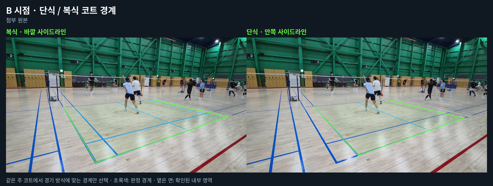
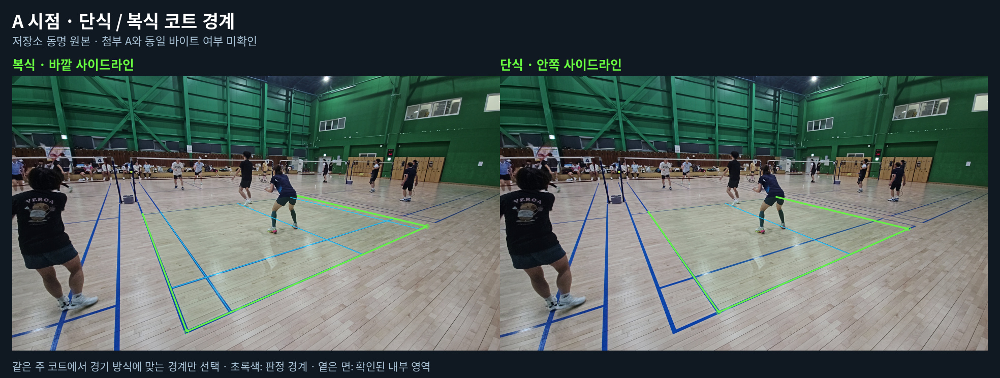

# 단일 시점 최종 판정과 단식·복식 선택 — 0.5.10

A/B 중 한 시점에서 유효한 IN·OUT이 나와도 상대 시점의 REVIEW·처리 실패·연결 미확인 때문에 최종 결과까지 보류하던 경로를 수정했다. 경기 방식 선택은 주 코트의 표시 경계와 실제 판정 규칙에 함께 적용한다.

## 사용법

Windows 패키지를 새 폴더에 압축 해제해 `START.bat`를 실행한다. A/B 영상을 고르고 **경기 방식**에서 단식 또는 복식을 선택한다. 기본값은 복식이다. **기존 검수 근거 활용을 끄고 새 분석**하면 현재 탐지와 선택한 경계를 적용한다. 결과를 다시 열면 적용 당시의 경기 방식을 표시하며, 집중 재분석도 그 규칙을 유지한다.

## 최종 판정

| 유효한 시점별 결과 | 최종 결과 |
|---|---|
| A IN / B REVIEW 또는 실패 | IN · A 근거 |
| A REVIEW 또는 실패 / B IN | IN · B 근거 |
| A OUT / B REVIEW 또는 실패 | OUT · A 근거 |
| A REVIEW 또는 실패 / B OUT | OUT · B 근거 |
| 양쪽 유효한 IN / OUT 충돌 | REVIEW |
| 양쪽 REVIEW | REVIEW |
| 서로 다른 랠리로 확인됨 | REVIEW |

한 시점만으로 판정하면 `decision_scope: single_view`와 근거 시점을 남긴다. 두 영상의 같은 사건 여부가 미확인이어도 독립적으로 유효한 시점의 판정은 유지한다. 이때 상대 영상에 판정을 전파하거나 두 시점의 좌표를 합치지 않는다. 중복 파일도 독립된 두 카메라의 증거로 세지 않는다. 잘못된 원본 식별값·다른 규칙·미확정 접촉은 유효한 판정 근거가 아니다.

카메라별 담당 라인을 지정하는 CLI 요청도 같은 원칙을 적용한다. OUT은 담당 경계 하나에서 충분한 바깥쪽 접촉 근거가 필요하고, 단일 시점 IN은 요청한 경계 전체를 담당하는 유효한 근거가 필요하다. 여러 시점의 부분 담당 범위를 합칠 때만 사건 대응과 공통 미터 좌표를 요구한다. 화면 픽셀 좌표는 카메라 사이에서 비교하지 않는다.

## 경기 방식과 코트 경계

단식은 실제 관측한 안쪽 양 사이드라인, 복식은 바깥쪽 양 사이드라인을 사용한다. 앞쪽 두 모서리가 보이는 같은 주 코트만 선택한다. 단식에서 양옆 복식 사이드 앨리는 관측 범위에 남겨 OUT을 판정할 수 있다. 전체 코트가 보이지 않을 때는 확인된 내부 범위와 관측된 경계만 사용하며, 범위를 닫는 임의의 선을 OUT 경계로 삼지 않는다.

선택한 규칙은 새 분석·저장 결과·화면·접촉 판정에 전달된다. 다른 경기 방식으로 저장한 검수 결과는 재사용하지 않고 원본을 새로 분석한다. 원본이 없으면 다른 규칙의 결과를 대신 쓰지 않는다. 서비스 규칙 선택은 이번 A/B 옵션에 포함하지 않는다.

## 검증

- 전체 Python 회귀 테스트: **1,192개 통과, GPU 관련 5개 건너뜀**.
- 마지막 보완 후 요청·A/B 통합·단식 코트·전체/부분 캘리브레이션·영상 파이프라인 집중 테스트: **177개 통과**.
- Chromium UI: 단식/복식 키보드 선택, 분석 중 선택 잠금, 요청 전달, 새로고침·재분석 규칙 유지, A만 IN·B만 OUT, 연결 경고 표시, 모바일 375/390px 확인. 8회 요청과 1회 업로드, JavaScript 오류 0개. [브라우저 기록](game-modes/browser-validation.json).
- A/B 실제 영상 각각 9프레임에서 두 경기 방식의 주 코트를 선택했다. 아래 비교는 실제 영상 픽셀에 탐지 결과를 그린 것이다. 파일명이나 참조 좌표를 탐지기에 입력하지 않았다.
- B 실제 첨부를 단식으로 새 전체 분석했다. 안쪽 경계 3개가 관측되었고, 12개 후보의 판정 규칙이 모두 단식 랠리로 전달됐다. 최초 접촉 확정 후보는 0개여서 최종 **REVIEW**였다. 34.65초는 이 CPU 실행의 측정값이다. [실행 요약](game-modes/automatic-B-singles-summary.json).

전체 회귀 실행 후 미터 좌표 기하 시험 결과(`geometry_only: true`)가 CLI의 판정 근거로 승격되지 않도록 보완했고, 위 177개 집중 시험에 해당 회귀 시험을 포함했다. UI 검증은 합성 미디어와 모의 API를 사용했으며 실제 자동 판정 정확도를 측정한 시험이 아니다. [UI 단일 시점 IN 표시](game-modes/ui-single-view-in.png).

B 전체 분석은 버전 문자열을 0.5.10으로 올리기 직전의 기능 코드에서 실행되어 원본 결과에는 `version: 0.5.9`가 남아 있다. 실행 전후 분석 구현 지문은 동일하며 요약에 기록했다. 이번 변경은 단일 시점 결과 연결과 경기 방식 선택을 검증한 것으로, 미확정 자동 접촉을 확정한 것으로 바꾸지 않는다.

## 실제 영상 출처와 사진

B는 사용자 첨부 원본이며 SHA256은 `bcac92b83d0e03f45acb66fdcf3fe6535acbef0aed53449ed96cfdf5aeb090e9`다. A는 첨부 전송 한도로 저장소의 같은 이름 원본을 사용했으며 SHA256은 `0cc88d220b046572383d67714b608881da45e15e5165b421d46b5b31667727bb`다. A가 현재 첨부와 같은 바이트인지는 확인하지 못했다.

초록색은 적용한 경기 경계, 옅은 면은 확인된 내부 범위다. 왼쪽은 복식, 오른쪽은 단식이다. [A 복식](game-modes/A-doubles.json) · [A 단식](game-modes/A-singles.json) · [B 복식](game-modes/B-doubles.json) · [B 단식](game-modes/B-singles.json)에 경계 좌표와 메타데이터를 보관했다.

Windows 패키지는 최신 소스와 위 검증 자료를 포함한다. Windows 실행 파일과 GPU 실기 동작은 Linux 환경에서 직접 실행 검증하지 못했다. [패키지 구성과 실행 방법](WINDOWS_PACKAGE.md)을 참고한다.
