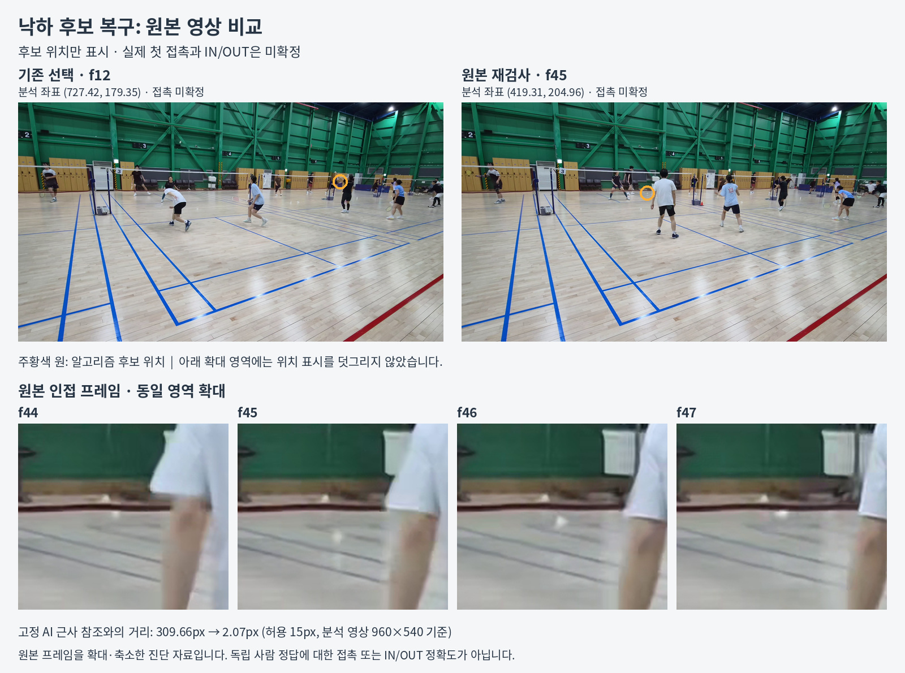
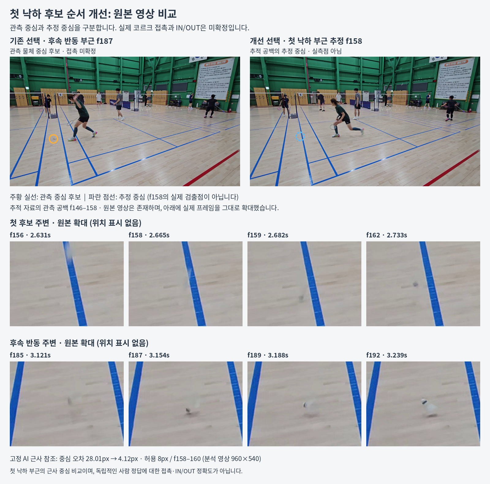

# 낙하 후보 엔진 0.5.7

공유된 실제 관측으로 첫 반동과 후속 반동을 구분하고, 끊긴 궤적 주변의 원본 픽셀을 다시 탐색합니다. 복구한 점이 작은 배경 조각으로 바뀌거나 사람과 겹치는 경우에는 비행 후보의 우선순위를 보류합니다. 후보 위치를 찾는 것과 최초 접촉·IN/OUT을 확정하는 것은 별개입니다.

고정된 AI 근사 참조에 대한 첫 낙하 부근 일치는 **7/17 → 9/17**, 별도 대조 영상은 **2/2 유지**였습니다. 기존 성공 사례의 회귀는 없습니다. 설정 확정 후 공개한 별도 검증에서는 **0/1 → 0/1**로, 새 영상에 대한 개선은 확인되지 않았습니다. **공식 판정은 개발·대조 34개와 별도 검증 4개 모두 REVIEW**입니다. 코르크의 최초 지면 접촉, 대상 셔틀, 코트 보정이 검증되지 않았기 때문이며, 이 조건을 낮추지 않았습니다.

## 설계와 적용 설정

| 단계 | 처리 | 보존하는 불확실성 |
|---|---|---|
| 실제 관측 | 원본 시각·해시·좌표를 보존하고 실제 픽셀 성분만 사용 | 보간점을 실측으로 승격하지 않음 |
| 원본 복구 | 연속 하강 경로의 끝에서 양방향 시간 변화·국소 대비를 재검사 | 새 경로도 신원 미확정 가설 |
| 외형·가림 확인 | 같은 프레임의 기존 가림 영역을 전달하고, 후속 성분의 지속적인 크기 붕괴를 검사 | 작은 조각의 연결을 접촉 증거로 사용하지 않음 |
| 사건 순서 | 실제 관측을 공유하는 경로와 중간 연결 궤적, 반동 궤선·속도 감소로 앞선 사건을 확인 | 시간상 빠르다는 이유만으로 라켓 타격을 착지로 선택하지 않음 |
| 진단 표시 | 후보 위치·최초 접촉·대상 식별·코트 보정·사건 선택·경계 오차를 분리 | 대표 후보와 전체 요청의 판정 범위를 구분 |

기본 `configs/poc.json`은 `causal_first_event_ranking`, `native_endpoint_recovery`, `native_rebound_guard`를 함께 켭니다. `event_family_diversity`는 고정 top1·recall 지표가 개선되지 않아 기본값을 끕니다. 선택적으로 켜는 경우에도 대안과 병합 관계를 보존합니다. 수동 타격 앵커가 있으면 신원 확인 전 병합·인과 재정렬을 제외하며, 접촉 모델을 쓰면 모델 평가 전 후보 병합을 제외합니다.

원본 복구는 카메라 안정성이 확인될 때만 실행합니다. 최대 24개 접근 경로, 경로 끝 이후 0.35초, 창별 최대 32개 시점과 768px 변 길이를 사용하고, 보관하는 crop은 총 128MiB로 제한합니다. 이 값은 프로그램 전체 RAM 제한이 아닙니다. 원본 복구·연결·판정은 CPU에서 수행되며, 기존 GPU 후보 전처리·모델 추론 경로는 유지됩니다.

외형 검사는 분석 좌표계에서 후속 원본 성분 3개의 중간 반지름이 접근 구간의 45% 이하이고, 세 점 모두 65% 이하로 작아지는 경우 비행 우선순위만 보류합니다. 관측·후보 좌표를 삭제하거나 신원·접촉을 확정하지 않습니다. 원본 복구에는 순차 디코딩을 사용하여 임의 탐색 후 영상 끝 프레임을 읽지 못하는 문제를 피합니다. 진단의 `decoded_frames`는 요청해 가져온 원본 프레임 수이며, 코덱 내부에서 건너가기 위해 처리한 모든 프레임 수는 아닙니다.

## 고정 평가와 반복 결과

기존 24개와 이후 진단에 사용된 8개는 개발·회귀 자료입니다. 그중 위치 비교가 가능한 17개만 주 평가의 분모에 넣고, 가림·불명확한 15개는 제외 사유와 실행 결과를 남깁니다. 대조 영상 2개는 별도로 보고합니다. 모든 참조는 AI의 최초 낙하 부근 중심 추정이며, 독립적으로 확인한 코르크 접촉·IN/OUT 정답이 아닙니다. 원본 SHA, 프레임 구간, 좌표계와 허용 오차는 실험 중 바꾸지 않았습니다.

아래 분모 19개에는 주 평가 17개와 대조 2개가 포함됩니다.

| 실험 | 첫 후보 일치 | Recall@6 / @12 | 채택 판단 |
|---|---:|---:|---|
| 기존 엔진 | 9/19 | 10/19 | 비교 기준 |
| 인과 순서만 개선 | 10/19 | 10/19 | 기존 9개 성공 유지, 1개 개선 |
| 후보 가족 묶기만 적용 | 9/19 | 10/19 | 지표 개선 없음, 기본 비활성 |
| 초기 원본 복구 | 6/19 | 11/19 | 회귀 4개와 디코딩 오류로 기각 |
| 초기 복구 + 인과 순서 + 가족 묶기 | 7/19 | 11/19 | 같은 회귀로 기각 |
| 가림·외형 검증을 보완한 복구 | 10/19 | 11/19 | 기존 성공 유지, 1개 개선 |
| 최종 복구 + 인과 순서 | **11/19** | **11/19** | 기존 성공 유지, 2개 개선 |

초기 원본 복구 두 실험은 34개 중 33개가 실행됐고, 원래 참조가 불명확한 `uhd4k-4-b`에서 프레임 126 탐색 오류가 발생했습니다. 오류를 별도 기록했으며 성공한 것처럼 집계하지 않았습니다. 최종 수정에서는 34개 모두 실행됐습니다.

- `8k-2-b`: 잘못된 f12 → 실측 중심 f45. 원본 반동 관측을 복구했습니다.
- `ordinary-1-a`: 후속 반동 f187 → 첫 낙하 부근 f158. 이 위치는 관측 공백의 전후 경로로 구한 **추정 중심**입니다.
- 초기 복구의 `control-1-b`, `8k-5-b`, `ordinary-12-a/b` 회귀는 가림 정보 전달과 외형 일관성 검사 후 모두 해소됐습니다.
- 탐색 예산 확대, 접근 경로 중간에서 재시작, 종단 감속, 어두운 성분 추가와 그 조합은 별도 실패 사례에서 시험하고 효과가 없는 변형은 채택하지 않았습니다.

실제 원본 비교:





## 실행 범위와 재현

저장소의 원본 74개는 해시·메타데이터를 모두 확인했고, 고유 SHA는 73개입니다. 이 검사를 74개 전체 추론 정확도로 표현하지 않습니다. 기준 엔진은 고정 34개와 별도 검증 4개를 원본부터 전체 분석했습니다. 개발 실험은 원본 프레임·탐지·추적·보정의 계약을 검증한 뒤 변경된 단계만 다시 실행했으며, 원본 복구와 접촉 근거는 실제 원본을 다시 읽습니다. 최종 설정으로는 개발·대조 34개를 변경 단계부터 재실행하고, 대표 개선·회귀·디코딩 사례 8개와 별도 검증 4개를 원본부터 전체 분석했습니다.

동일 엔진의 전체 실행과 재사용 실행에서 후보 12개와 판정이 일치했고, 디스크 캐시를 사용해도 원본 픽셀 해시와 결과가 같음을 확인했습니다. 최종 전체 실행 8개도 재사용 실행의 선택 좌표·평가·판정과 일치했습니다. 캐시는 참조 좌표를 입력으로 사용하지 않습니다.

별도로 남겨 둔 4개 영상은 코드·설정을 동결한 뒤 참조를 공개했습니다. 양쪽 엔진 모두 4개 전체 실행을 완료했으며, 비교 가능한 `uhdhd-3-a`는 기존·개선 엔진 모두 첫 낙하를 놓쳤습니다. 나머지 3개는 대상이나 첫 낙하가 불명확하여 위치 정확도 분모에서 제외했습니다. 별도 top1·recall@6·recall@12는 모두 **0/1 → 0/1**이고, 개발 자료의 분모와 합치지 않습니다. 이 결과를 보고 설정이나 참조를 다시 조정하지 않았습니다.

전체 자동 테스트는 **986개 통과, GPU 하드웨어가 필요한 5개 미실행**입니다. 데스크톱·모바일 크기의 브라우저에서는 진단 표시용 데이터로 새 화면을 확인했습니다. 이는 실제 영상 추론이나 GPU 실기 검증을 대신하지 않습니다.

```bash
# 현재 설정으로 고정 34개 원본 전체 분석
python scripts/evaluate_landing_engine.py --mode full --variant current-full --config configs/poc.json --workers 1

# 원본·코드·설정 계약이 맞는 기존 baseline으로 변경 단계 재실행
python scripts/evaluate_landing_engine.py --mode replay --variant current-replay --baseline runs/landing-engine/baseline --config configs/poc.json --frame-cache runs/landing-engine/frame-cache
```

기준 소스는 `3b9595cf6ee731f45296bd7425544e82f2eb5d65`입니다. 별도 소스 디렉터리는 `--repo`, 원본 디렉터리는 `--video-dir`로 지정합니다. 다른 위치에 보존한 과거 평가 스크립트를 실행할 때는 `--assets-root`, `--protocol`, `--video-dir`, `--output-root`를 명시합니다. 과거 스크립트와 현재 스크립트의 지문을 섞어 기존 실험 폴더를 덮어쓰지 않습니다.

검증 자료는 [전체 비교 기록](landing-engine/comparison.json), [평가 프로토콜](landing-engine/protocol.json), [설정 동결](landing-engine/accepted-freeze.json), [원본 목록](landing-engine/source-inventory.json), [원본 복구 실험](landing-engine/recovery-experiments.json), [인과 순서·후보 가족 실험](landing-engine/causal-family-experiments.json), [디코딩 회귀 검사](landing-engine/native-decoding-regression.json), [실행 환경·테스트 기록](landing-engine/environment.json)에 보존합니다. 생성된 전체 관측 배열과 영상은 `runs/landing-engine/`에 저장됩니다.

## 종료 기준과 남은 문제

기존 성공을 유지하는 변경만 기본 설정에 반영했습니다. 채택한 최종 설정에서 탐색 예산 확대·접두 궤적·종단 감속·어두운 성분 조합의 추가 가설 5개를 다시 실행했습니다. 해당 실패 사례에서는 각 실행의 제한 전 후보 1,697~1,735개에도 고정된 첫 낙하 부근에 맞는 후보가 없었으며, top1·recall@6·recall@12의 추가 개선은 모두 0이었습니다. [최종 재검증 기록](landing-engine/v5-recovery-rechecks.json)에 결과·후보 추적·재현 방법을 보존했습니다. 추가 측정 이득이 없고 전체 회귀·통합 검사가 통과하여 이번 반복을 종료했습니다. 이는 시험한 대안과 영상에서의 종료이며, 앞으로 가능한 모든 알고리즘이 개선될 수 없다는 뜻은 아닙니다.

별도 검증 실패의 [단계별 분석](landing-engine/reserved-source/failure-analysis.json)에서는 첫 낙하 참조 구간 f137~139에 셔틀 근처의 탐지·실제 궤적 관측이 모두 없었습니다. 원본 복구도 카메라 안정성을 확인할 배경 정합 근거가 부족하여 실행되지 않았습니다. 큰 카메라 움직임이 관측됐다는 뜻은 아닙니다. 반환 후보 12개에 올바른 사건이 없어 재정렬만으로 해결할 수 없으며, 희미한 셔틀 탐지와 배경 정합이 다음 개선 과제입니다.

여전히 희미한 셔틀 누락, 깃털·코르크·그림자의 잘못된 연결, 다른 코트의 물체 선택이 남습니다. 공식 IN/OUT을 확정하려면 최초 접촉·대상 신원·코트 평면의 독립적인 근거가 필요합니다. `REVIEW` 비율을 줄이기 위해 이 조건이나 참조 오차 범위를 완화하지 않았습니다.
