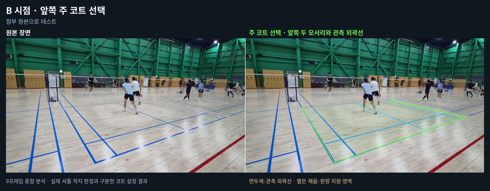
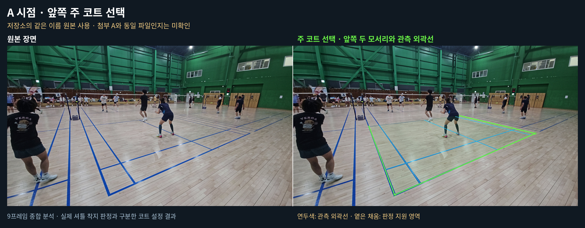

# 주 코트 선택과 화면 좌표 판정

0.5.9는 전체 코트 보정이 어려운 부분 영상에서 앞쪽 두 모서리가 보이는 코트 하나를 선택한다. 모든 직선 후보를 경기 경계로 표시하던 동작 대신, 선택한 코트의 관측 외곽선과 내부 선만 표시한다. 중앙 서비스라인과 단식 사이드라인을 복식 외곽선으로 오인하지 않도록 라인 간격과 영상의 실제 선 지지를 함께 확인한다. 선택에 실패하면 다른 코트의 후보 선을 대신 표시하지 않는다.

선택 결과는 `calibration.primary_court`에 저장한다. 전체 미터 좌표 보정 결과와 별개이며, 부분 코트 선택이 성공해도 기존 `homography`의 정확도가 확인된 것으로 바꾸지 않는다. 초록색은 확인된 외곽선이고 원은 가까운 두 모서리다. 옅은 내부 영역의 먼 쪽 닫힘선은 실제 경기 경계로 그리지 않는다.

## IN·OUT 적용 범위

선택한 단식·복식 랠리 규칙으로 확인된 최초 접촉 위치를 주 코트의 화면 좌표 경계와 비교한다. 0.5.10부터 단식은 안쪽 사이드라인을, 복식은 바깥쪽 사이드라인을 사용한다. [경기 방식 선택과 검증](GAME_MODES.md)을 참고한다.

- 확인 가능한 내부 영역과 접촉 영역이 위치 오차를 고려해 겹치면 `IN`이다.
- 관측된 외곽선 바깥에 가능한 접촉 영역 전체가 있으면 `OUT`이다.
- 라인 근처의 위치 오차가 판정을 바꿀 수 있거나 선택 영역에서 먼 접촉이면 `REVIEW`다.
- 확인 범위를 자르기 위한 선이나 보이지 않는 네트를 `OUT` 경계로 사용하지 않는다.

부분 코트 경로는 단식·복식 랠리를 지원한다. 서비스에는 해당 경계를 확인한 전체 코트 보정이 필요하다. 같은 분석 영상의 모든 프레임에서 카메라 고정이 확인돼야 선택한 경계를 판정에 사용할 수 있다. 화면의 코트 선택만으로 셔틀의 신원이나 최초 접촉이 확정되지는 않는다. 실제 접촉 근거가 없는 운동 후보는 계속 `REVIEW`이며, 기존 검수 화면의 확인된 접촉 근거도 같은 경계 판정 함수를 사용한다.

## 적용

새 분석에 기본으로 적용된다. 기존 결과 파일에는 선택한 코트가 없으므로 A/B 화면에서 **기존 검수 재사용을 끄고 새 분석**을 실행한다. 선택한 경계는 결과 이미지, 대표 장면, 근거 영상에 공통으로 표시된다. 기존 전체 코트 보정과 단식·서비스 규칙은 유지된다.

진단용으로 기존 전체 보정만 실행하려면 설정에 `"calibration": {"primary_court_enabled": false}`를 지정할 수 있다. 이는 주 코트 선택과 부분 코트 판정을 모두 끈다.

## 검증 자료의 의미

실제 A/B 장면의 모서리 참조는 원본에서 AI가 근사 확인한 회귀 시험용 좌표다. 탐지기에 참조 좌표나 파일 이름을 입력하지 않는다. 실제 영상의 주 코트 선택 시험과 합성 접촉점의 IN·OUT 소프트웨어 시험을 구분하며, 합성 접촉점을 실제 셔틀 착지 결과로 표시하지 않는다.

실제 A/B 각각 9프레임에서 주 코트가 선택됐다. B는 사용자 첨부 원본이고, A는 첨부파일 전송 한도 때문에 저장소의 같은 이름 원본을 사용했다. A가 현재 첨부와 동일한 바이트인지 확인하지 못했다. 선택한 모서리는 960×540 분석 좌표에서 A `(342.9,502.4)`, `(816.0,294.5)`, B `(359.2,501.2)`, `(882.8,317.4)`다. 상세 출처와 합성 접촉 시험은 [validation.json](primary-court/validation.json)에 기록했다.

전체 Python 회귀 시험은 **1124개 통과, GPU 관련 5개 건너뜀**이다. 최종 변경을 포함한 코트·판정·이벤트·설명 집중 시험은 173개 통과했다. Chromium의 A/B 화면 시험에서 주 코트 선택·선택 실패·기존 결과 표시를 확인했다. 카메라 이동, 잘못된 경계 역할, 서비스 중앙선 혼동, 경계 밖 범위, 관측이 없는 접촉은 별도 회귀 시험으로 검사했다.

A 저장소 원본과 B 첨부 원본의 전체 운영 파이프라인에서도 코트 선택과 영상 출력이 완료됐다. 실제 영상의 최종 판정은 접촉·식별 근거와 사건 후보가 확정되지 않아 `REVIEW`였다. 코트 보정 미승인 때문에 무조건 차단되던 조건은 제거됐지만, 이 결과를 실제 경기의 IN·OUT 정확도 검증으로 해석해서는 안 된다.
