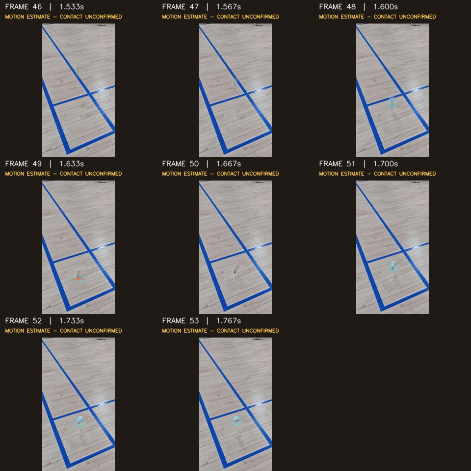
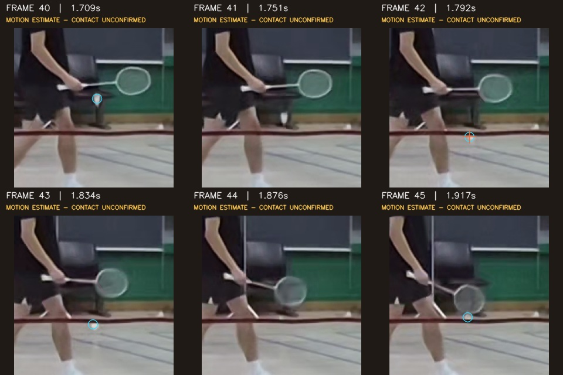

# 셔틀콕 추적·첫 착지 추정 수정 — 0.5.2

두 입력 영상에서 수동 좌표나 이전 검수 기록 없이 실제 셔틀콕의 하강 경로와 첫 반등 부근을 선택하도록 수정했습니다. A는 49프레임(1.633초), B는 42프레임(1.792초)을 대표 후보로 선택합니다. B의 접촉 부근은 선수·네트와 겹치므로 전후 구간으로 검토해야 합니다. 두 결과 모두 물리적 접촉 확정 및 IN/OUT 판정은 `REVIEW`입니다.

## 입력과 검증 범위

- A: `8k 30 4k 24 a시점 1.mp4`, 7680×4320, 108프레임. 첨부 전송 도구의 32MiB 제한 때문에 저장소의 같은 이름 원본을 사용했습니다. 첨부 A와 바이트 단위 동일성은 확인하지 못했습니다.
- B: `8k 30 4k 24 b시점 1.mp4`, 3840×2160, 82프레임. 실제 첨부 파일을 사용했고 저장소 원본과 Git blob 해시가 일치합니다.
- 각 원본의 SHA256, 실행 결과, 처리 시간은 [검증 기록](shuttle-tracking-fix/validation.json)에 있습니다.
- 이 영상들을 보고 문제를 진단하고 개발했으므로 독립 평가 데이터가 아닙니다. 원본 프레임을 AI가 시각 대조한 개발 검증이며, 독립 사람이 표시한 정답에 대한 정확도 수치가 아닙니다.

## 재현된 문제와 수정

1. 밝은 바닥에서 흐린 어두운 잔상이 빠졌고, 흰 깃털이 선수의 어두운 윤곽에 붙어 큰 물체로 제거됐습니다. 원본을 직접 축소한 픽셀에서 밝은 후보와 어두운 후보를 따로 분할합니다.
2. 원본 해상도에서 발견한 고득점 잡음이 전역 후보를 밀어냈습니다. 전체 80개 한도 안에서 전역 후보 64개의 자리를 보존하고, 원본 재탐지와 새 후보를 추가합니다.
3. 가까운 한 프레임 후보만 따라가면 사람의 옷·신발로 경로가 바뀌었습니다. 제한된 수의 여러 비행 경로를 함께 비교하고 연속 관측·이동 거리·곡선 적합 오차로 검토할 경로를 선택합니다.
4. 처음 튄 위치보다 나중의 정지 위치가 높은 순위를 받았습니다. 하강 후 첫 반등과 반등 전 평탄한 최고점 구간을 구분합니다. 가림 구간의 추정은 실제 관측으로 채워 넣지 않습니다.
5. 근거 화면과 별도 추적 경로 재생 영상은 선택한 경로에 집중하고, 관측이 없는 구간의 실선을 끊습니다. 확인되지 않은 코트 다각형은 숨기며, 확대 이미지에 원본 프레임·시각과 접촉 미확인 표시를 유지합니다.

## 같은 원본의 수정 전후

모든 위치는 **960×540 분석 화면의 물체 중심 근사 좌표**입니다. 코르크의 실제 바닥 접촉점이나 코트 위 거리(cm)가 아닙니다. 프레임 번호는 0부터 시작합니다.

| 시점 | 수정 전 대표 후보 | 수정 후 대표 후보 | 수정 후 검토 구간 |
|---|---|---|---|
| A | 76프레임 · 2.533초 · (400.6, 459.6), 여러 번 튄 뒤 위치 | **49프레임 · 1.633초 · (360.9, 447.2)**, 카메라 앞 첫 반등 부근 | 48–51프레임 · **1.600–1.700초** |
| B | 59프레임 · 2.501초 · (356.5, 180.5), 배경 선수 부위 | **42프레임 · 1.792초 · (396.7, 200.3)**, 실제 셔틀 낙하 부근 | 40–45프레임 · **1.709–1.917초** |

A의 시각 대조 기준 (361,442) 부근과 약 5픽셀, B의 (397,202) 부근과 약 2픽셀 차이입니다. 이 기준점 자체도 근사값이므로 측정 정확도로 해석하지 않습니다. 모션 블러와 가림 때문에 여전히 일부 프레임에서 관측이 빠지며, 전체 비행을 매 프레임 완벽하게 추적했다는 뜻이 아닙니다.

### A 원본 전후 프레임

하강 → 첫 반등 → 올라온 셔틀을 비교할 수 있습니다. 청록색 원은 해당 프레임에서 선택한 관측점이고, 붉은 표시는 첫 착지 추정 후보입니다. 표시가 없는 프레임의 관측점은 만들어 넣지 않았습니다.

### B 원본 전후 프레임

셔틀이 선수 오른편으로 내려오며 네트와 겹칩니다. 42–43프레임의 평탄한 최고점과 가림을 포함한 넓은 검토 구간을 제시합니다. 정확한 코르크 접촉 순간을 확정하지 않습니다.

## 실행 검증

- 전체 Python 테스트 **468개 통과**.
- Linux Chromium에서 실제 두 원본을 업로드하고 기본 새 분석으로 실행했습니다. A/B 7단계 진행, 결과·확대 근거, 새로고침 복원, 390px 화면 가로 넘침 없음, JavaScript 오류 0개를 확인했습니다.
- 별도 추적 영상 UI는 완료 결과의 실제 MP4와 메타데이터를 연결한 브라우저 검증으로 확인했습니다. 원본 시각과 잘라낸 영상의 0초를 구분하며, 원본 구간 이동과 추적 영상 재생은 서로 독립적입니다.
- 이전 검수 재사용, 수동 타격 앵커, 지정 좌표·구간은 사용하지 않았습니다. 두 결과 모두 `assistance_used=false`입니다.
- 선택된 모든 궤적 관측점이 실제 저장된 탐지 후보에 존재합니다. 관측 누락 구간은 보존합니다. 근거 MP4의 원본 프레임·시각 정렬을 검증했습니다.
- 이 환경에서 A 약 116초, B 약 32초, 동시 작업 전체 약 117초가 걸렸습니다. PC 성능에 따라 달라지며 남은 시간 예측값이 아닙니다.
- 독립 검토에서 잘못된 배경 선수·나중 정지점 대신 실제 셔틀의 첫 반등 부근이 선택됨을 확인했습니다. 코트 보정·접촉·신원 확정 조건은 완화하지 않았습니다.

## 실행 패키지

[Windows 0.5.2 ZIP 다운로드](https://github.com/6rmkhj/Badminton_AI_Line_Judge/archive/refs/heads/downloads/windows-portable-0.5.2.zip)

새 폴더에 전부 압축 해제하고 `START.bat`을 실행하세요. 기존 패키지 폴더와 섞지 마세요. Windows 런타임 구성 요소는 이전 패키지와 같으며, Windows 실행 파일 자체는 Linux 환경에서 직접 실행 검증하지 못했습니다.
