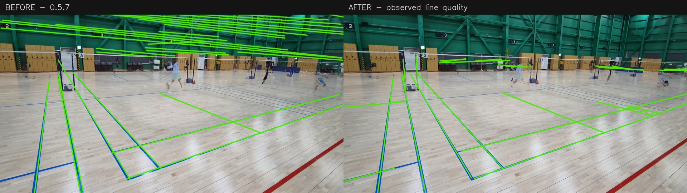
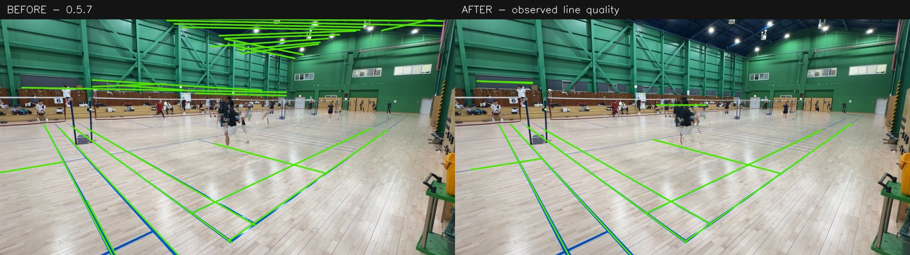
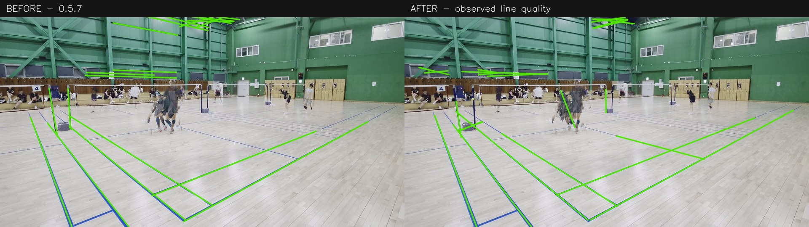

# 코트 라인 영상 재생 검증

저장소의 기존 경기 영상 8개에서 **보이는 코트 선의 보존과 벽·천장 오탐 감소**를 비교했다. 같은 체육관의 네 촬영 설정에서 A/B 시점을 골랐다. 각 영상의 고정된 9프레임을 960×540으로 추출해 두 버전에 동일하게 입력했다. 실제 전체 분석 파이프라인 검증과는 구분되는 캘리브레이션 단계 재생 평가다.

| 항목 | 0.5.7 원본 | 개선 코드 |
| --- | ---: | ---: |
| 라인이 검출된 영상 | 8/8 | 8/8 |
| 근사 참조 선 샘플의 5px 이내 검출 비율 | 95.90% | 97.42% |
| 샘플 80% 이상이 검출된 참조 선 | 37/40 | 37/40 |
| 명백한 벽·천장 영역에 검출된 선 길이 합 | 42021.9px | 7054.8px |
| 전체 코트 보정 승인 | 0/8 | 0/8 |

명백한 비코트 영역에 검출된 선 길이는 **83.2% 감소**했다. 이 수치는 모든 오탐을 센 정밀도가 아니다. 바닥의 나무결, 네트, 선수, 인접 코트의 선이 남아 있을 수 있다. 출력 선분의 분할 방식과 최대 개수도 바뀌므로 단순 선분 수는 개선율로 쓰지 않는다.

참조는 코드 변경 전 원본 이미지에서 AI가 근사 표시한 40개 선분과 보수적인 비코트 영역이다. 독립 사람이 측량한 정답이 아니며, 동일 영상으로 개선을 반복했으므로 별도 검증 자료나 새로운 체육관에 대한 일반화 성능으로 해석하지 않는다. 참조 좌표는 평가에만 쓰며 `calibrate()`에는 전달하지 않는다.

**전체 코트 좌표계의 성공률은 개선되지 않았다.** 영상들은 원근이 강한 부분 코트 시야이고, 인접 코트가 함께 보인다. 선의 역할과 전체 경계가 확인되지 않은 결과는 `REVIEW`, `metric_coordinates_available=false`를 유지한다. 접촉·인아웃 정확도를 측정한 시험도 아니다. case_01은 근사 샘플 커버리지가 99.06%에서 95.00%로 낮아졌으므로 모든 영상의 개별 지표가 개선됐다고 주장하지 않는다.

| 사례 | 원본 영상 | 참조 커버리지 전 | 후 | 비코트 선 길이 전 → 후 (px) |
| --- | --- | ---: | ---: | ---: |
| case_01 | 8k 30 4k 24 a시점 4.mp4 | 99.06% | 95.00% | 4658 → 1179 |
| case_02 | 8k 30 4k 24 b시점 4.mp4 | 100.00% | 100.00% | 11070 → 0 |
| case_03 | a-4시점(uhd30 4k30).mp4 | 100.00% | 100.00% | 1494 → 1957 |
| case_04 | b-3시점(uhd30 4k30).mp4 | 97.81% | 100.00% | 9116 → 225 |
| case_05 | a시점(uhd30 hd30) 2.mp4 | 94.69% | 94.69% | 770 → 0 |
| case_06 | b시점(uhd30 hd30) 3.mp4 | 94.69% | 98.12% | 8000 → 0 |
| case_07 | a시점 4.mp4 | 99.38% | 100.00% | 2596 → 2124 |
| case_08 | b시점 7.mp4 | 81.56% | 91.56% | 4318 → 1571 |

## 전후 이미지

초록색은 출력된 관측 선분이다. 이 비교에서는 승인되지 않은 코트 사각형 가설을 표시하지 않는다. 원본 프레임에서 바닥 선을 보존하면서 벽·천장의 잘못된 선이 줄었는지 확인할 수 있다.







## 재현

`manifest.json`의 원본 영상 경로, 원본 SHA256, 표시 프레임 번호와 픽셀 해시를 사용한다. 프레임 캐시가 없으면 FFmpeg가 지정된 프레임만 추출하며 원본 해시와 캐시 픽셀 해시가 다르면 실행을 중단한다. 소스가 평가 도중 변경되어도 보고서를 승인하지 않는다.

```bash
git show 59c20cbf94d3d325651c3f71cabba9a2a80fa576:badminton/calibration.py > /tmp/calibration-baseline.py
python scripts/evaluate_calibration.py --manifest docs/court-calibration/manifest.json --video-root . --cache-root runs/court-calibration/cache --output runs/court-calibration/baseline --module /tmp/calibration-baseline.py
python scripts/evaluate_calibration.py --manifest docs/court-calibration/manifest.json --video-root . --cache-root runs/court-calibration/cache --output runs/court-calibration/current
```

원본 영상이 작업 폴더에 있어야 한다. 큰 영상과 프레임 캐시는 이번 변경에 중복 첨부하지 않았다. 계산 상세는 `baseline.json`, `final.json`, `comparison.json`에 있고, 선택한 중간 실험은 `experiments.json`에 기록했다. 중간 실험 기록은 전체 실험 이력이 아니며 최종 검증 결과를 대신하지 않는다.

보정 모듈 기준 원본 SHA256: `068c65e343b3fbd27dcb7ccfb5dc6dce8bdc874731def0e1ec962fd2d1cc83fd`
최종 SHA256: `36f4687f86887fa2b104d309400065c4fc0e69f10f97783d906beb1ee8222dcc`
